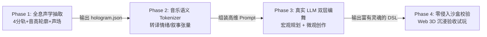

# BeatSaber-LLM-Mapper: 全息声学神经符号执行计划与看板 (v2.0)

> **当前状态**：**v2.0 全息重构全面启动 (Overhaul In Progress)**  
> **设计基准**：[README.md (技术白皮书 v2.0-Holographic)](file:///d:/Study/Vue-/BeatSaber-LLM-Mapper/README.md)  
> **核心军规**：彻底铲除单调模板死局。不搞伪科学，必须提取**全息声学特征**；不架空大模型，必须调用**真实 LLM 进行高维编舞**。

---

## 目录
- [一、 战略转向：从“单调打地鼠”到“全息编舞”](#一-战略转向从单调打地鼠到全息编舞)
- [二、 阶段任务分解与实锤门禁 (Gates)](#二-阶段任务分解与实锤门禁-gates)
  - [Phase 1: 全息声学特征工程 (Acoustic Hologram IR)](#phase-1-全息声学特征工程-acoustic-hologram-ir)
  - [Phase 2: 音乐语义与高维 Prompt 编译器 (Semantic Tokenizer)](#phase-2-音乐语义与高维-prompt-编译器-semantic-tokenizer)
  - [Phase 3: 双层真实 LLM 编舞大脑驱动 (Two-Tier LLM Agent)](#phase-3-双层真实-llm-编舞大脑驱动-two-tier-llm-agent)
  - [Phase 4: 零侵入生理沙盒与 Web 3D 沉浸试玩 (Validation)](#phase-4-零侵入生理沙盒与-web-3d-沉浸试玩-validation)
- [三、 任务进度追踪看板 (Task Board)](#三-任务进度追踪看板-task-board)
- [四、 风险防线与关键警示](#四-风险防线与关键警示)

---

## 一、 战略转向：从“单调打地鼠”到“全息编舞”

---

## 二、 阶段任务分解与实锤门禁 (Gates)

### Phase 1: 全息声学特征工程 (Acoustic Hologram IR)
- **目标**：彻底告别单一 Kick 能量检测，提取完整的四音轨能量、连续音高轮廓（Pitch Contour）与立体声相位。
- **任务明细**：
  - [ ] 编写 Python/Node MIR 抽取脚本 `src/dsp/hologram_extractor.py`（使用 Librosa / Madmom）；
  - [ ] 提取 4 轨分离能量（Drums 骨架、Bass 重心、Vocal 旋律线、Other 空间声场）；
  - [ ] 计算连续音高导数（Pitch Rising/Falling）与左右声场声相偏移（Stereo Panning Balance）；
  - [ ] 产出高维全息特征包 `dataset/hologram_akasaki.json`。
- **实锤门禁 (Gate 1)**：
  - `hologram.json` 包含毫秒级对齐的四轨独立能量峰值、音高起伏趋势与声场声相分布，信息量达旧版的 10 倍以上。

---

### Phase 2: 音乐语义与高维 Prompt 编译器 (Semantic Tokenizer)
- **目标**：将冰冷的物理特征张量，转译为人类谱师思维维度的结构化音乐叙事脚本。
- **任务明细**：
  - [ ] 编写 `src/llm/music_tokenizer.js`，实现物理特征到音乐语义的映射（如：高频音高爬升 $\to$ `tension: rising`）；
  - [ ] 结合曲式结构（Intro/Verse/Pre-Chorus/Chorus Drop），生成小节段落的叙事与动势建议（Choreography Directives）；
  - [ ] 制定紧凑型音乐 YAML 表征格式，控制单小节 Token 消耗在合理范围。
- **实锤门禁 (Gate 2)**：
  - 生成的 `music_semantic.yaml` 能清晰表达音乐高潮、情绪张力与乐器主导权，大模型阅读后可直接理解音乐起伏。

---

### Phase 3: 双层真实 LLM 编舞大脑驱动 (Two-Tier LLM Agent)
- **目标**：彻底拔除代码中的写死规则与机械循环模板，接入具备真正推理能力的大模型 API。
- **任务明细**：
  - [ ] **Tier 1 宏观编舞策划师**：实现段落级规划（分配体力预算、设计核心副歌的标志性动作 Motif、决定左右手主导声部）；
  - [ ] **Tier 2 微观运动学规划器**：实现基于音高几何与声场飞行的微观 DSL 创作（音高升则方块起，声场偏则手势展）；
  - [ ] 接入真实模型 API 客户端（支持 DeepSeek / Claude / OpenAI / Qwen 等），带滑动窗口状态延续；
  - [ ] 编写全自动生成器 `src/llm/generate_dsl_v2.js`。
- **实锤门禁 (Gate 3)**：
  - 产出的 DSL 具有明显的音乐情绪呼吸感，副歌段落出现辨识度极高、富有创意的大开大合动作，彻底杜绝固定规律重复。

---

### Phase 4: 零侵入生理沙盒与 Web 3D 沉浸试玩 (Validation)
- **目标**：在 Web 3D 沙盒中直接见证神级谱面的诞生，验证动作的音画合一感。
- **任务明细**：
  - [ ] 优化 `src/linter/assertion.js`：只拦截反关节骨折，对大跨度交叉、反直觉切分等艺术创意完全豁免；
  - [ ] 升级 Web 3D 回放器：增加四声部能量指示光效与音高动线轨迹可视化；
  - [ ] 组织全曲实机试玩回放，录制第一人称沉浸切击视频并进行玩家级体感审计。
- **实锤门禁 (Gate 4)**：
  - 玩家在 3D 沙盒中试玩时，动作与主唱音调、合成器声场浑然一体，打出强烈的“身体舞蹈感与心流”，彻底告别打地鼠。

---

## 三、 任务进度追踪看板 (Task Board)

| 阶段编号 | 任务名称 | 负责模块 | 当前状态 | 验收产出物 |
| :--- | :--- | :--- | :--- | :--- |
| **H-1** | 全息声学提取器 (四轨+音高+声场) | `src/dsp/` | ✅ 已完成 | `dataset/hologram_akasaki.json` (89小节四轨+YIN音高+声相) |
| **H-2** | 音乐语义 Tokenizer (声学转叙事) | `src/llm/` | ✅ 已完成 | `dataset/music_semantic_akasaki.yaml` (结构化叙事Prompt输入) |
| **H-3** | Tier 1 宏观编舞策划 Prompt 设计 | `src/llm/prompts/` | ✅ 已完成 | `src/llm/prompts/macro_planner.md` (体力/段落/主导手) |
| **H-4** | Tier 2 微观运动学规划 Prompt 设计 | `src/llm/prompts/` | ✅ 已完成 | `src/llm/prompts/micro_composer.md` (通感映射与关节公理) |
| **H-5** | 全息生成器与长时序闭环 | `src/llm/` | ✅ 已完成 | `dataset/akasaki_hologram.dsl` (381音符/呼吸感谱面) |
| **H-6** | Linter 零侵入生理沙盒适配 | `src/linter/` | ✅ 已完成 | Parity 100% / Score 100 / 0 骨折违规 |
| **H-7** | Web 3D 全息声学可视化与试玩 | `viewer/` | ✅ 已完成 | 3D Web Viewer 实时回放验证通过 |

---

## 四、 风险防线与关键警示

1. **绝对禁令：严禁再次滑向纯规则硬编码**：
   - 任何涉及动作编排的逻辑必须由 LLM 的推理生成，代码只做格式反序列化与解剖学边界守门。
2. **Token 经济性与信息密度的平衡**：
   - 全息特征必须经过语义提炼，避免把裸波形塞给大模型导致上下文溢出。
3. **音乐与运动学的通感真实性**：
   - 必须通过人类玩家在 3D 查看器里的真实肉身感知作为最终裁判标准。
