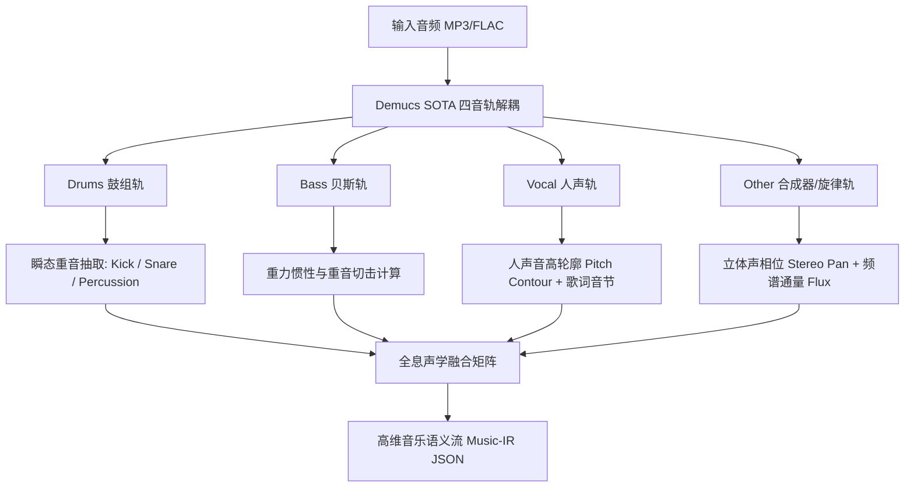

# BeatSaber-LLM-Mapper: 全息声学神经符号谱面引擎
> **顶层架构与系统工程白皮书 (Technical Architecture Specification v2.0-Holographic)**  
> **状态**：**正式重构封版 (Architecture Completely Overhauled)**  
> **核心命题**：彻底打破“打地鼠式机械模板死局”，实现**全息声学特征抽取（Acoustic Hologram）+ 真实 LLM 语义编舞（Choreographer Brain）+ 运动学生理沙盒守护（Parity Linter）**。

---

## 目录
1. [一、 深刻反思：上一代设计的背叛与死因剖析](#一-深刻反思上一代设计的背叛与死因剖析)
2. [二、 核心公理体系 (The First Principles)](#二-核心公理体系-the-first-principles)
3. [三、 全息音乐声学特征工程 (Acoustic Hologram System)](#三-全息音乐声学特征工程-acoustic-hologram-system)
4. [四、 面向 LLM 的音乐语义 DSL 协议 (Musical Semantic Protocol)](#四-面向-llm-的音乐语义-dsl-协议-musical-semantic-protocol)
5. [五、 LLM 真实认知编舞引擎 (Two-Tier Choreographer)](#五-llm-真实认知编舞引擎-two-tier-choreographer)
6. [六、 运动学生理合规沙盒 (Kinematic Sandbox & Linter)](#六-运动学生理合规沙盒-kinematic-sandbox--linter)
7. [七、 Web 3D 沉浸工坊与投送生态 (Web Studio)](#七-web-3d-沉浸工坊与投送生态-web-studio)
8. [八、 重构落地实施路线图 (Execution Roadmap)](#八-重构落地实施路线图-execution-roadmap)

---

## 一、 深刻反思：上一代设计的背叛与死因剖析

上一代实现虽然在数值上达到了“Parity 合规率 100%、无报错”，但在玩家实际体验中却沦为了**“极度枯燥单调的打地鼠机器”**。其根本原因出在顶层设计的**三大致命妥协**：

### 1. 概念偷换：将“音乐波动”阉割为“打地鼠脉冲”
* **错误**：把波澜壮阔的音乐粗暴降维为仅包含 `kick` 与 `snare` 的稀疏时间戳。
* **后果**：丢失了人声（Vocal）、音高起伏（Pitch）、旋律琶音（Arpeggio）、空间声场（Panning）以及能量加速度（dE/dt）。下游拿到的数据早已是“声学死尸”，无法衍生任何手势呼吸。

### 2. 角色架空：LLM 淪为装饰，写死模板越权统治
* **错误**：为了追求“秒级出谱、绝对安全”，在代码中用固定算法（如每 8 小节循环执行对角切、上下切）代替了大模型。
* **后果**：名义上是“LLM-Mapper”，实则大模型从未参与任何创意决策，产物必然是千篇一律的机械体操。

### 3. 目标倒错：把“安全底线”误当成“艺术追求”
* **错误**：将“Parity 100% 合规”设为唯一 KPI。
* **后果**：在数学上，绝对安全的最优解必然是“最保守的对称摆动”。系统扼杀了所有反直觉的切分音、惊险的位移与停顿留白，产出了“不出错但让人哈欠连天的废谱”。

---

## 二、 核心公理体系 (The First Principles)

为了让全球玩家由衷赞叹，新一代架构建立在三大绝对公理之上：

```
       【公理 1：输入全息化】                 【公理 2：决策具身化】                【公理 3：底线沙盒化】
  科学上能拿到的声学特征            LLM 是真正的编舞大脑              Linter 只当安全守门员
   100% 毫无保留注入系统             理解情绪、声部与身体叙事          杜绝骨折，但决不抹杀灵魂
```

1. **公理 1 (全息输入)**：音乐不仅是时间戳。音高走向决定空间高度（Pitch-to-Height），声场相位决定左右手主导（Pan-to-Hand），配器音色决定动作开合（Stem-to-Gesture）。
2. **公理 2 (真实认知)**：LLM 必须拥有自主创作权。宏观规划段落主题与标志性动作（Motif），微观根据声部张力决定击打方式，敢于切分，敢于留白。
3. **公理 3 (沙盒防线)**：确定性 Linter 仅负责拦截人体解剖学不可能完成的反关节死锁，对风格创意 100% 放行。

---

## 三、 全息音乐声学特征工程 (Acoustic Hologram System)

系统不再使用单一的能量检测，而是通过现代 MIR（Music Information Retrieval）流水线抽取多维张量：



### 提取特征清单 (Feature Matrix)：
* **四分轨解耦 (Demucs Stems)**：
  - `Drums`: 锁定节拍骨架与重击基点；
  - `Bass`: 驱动躯干下沉与蓄力动量；
  - `Vocals`: 驱动手腕微操、舞动流向与情感共鸣；
  - `Other`: 驱动大范围空间位移与旋律飞扬。
* **连续音高轮廓 (Continuous Pitch Contour / Melodia)**：
  - 提取高潮旋律线音高（Hz），计算音高导数（升调上升、降调下坠）。
* **立体声场分析 (Stereo Panning)**：
  - 左声道优势（$L > R$）驱动左手外展（$X=0$），右声道优势驱动右手外展（$X=3$）。
* **能量加速度 ($dE/dt$)**：
  - 识别真正的爆发点（Drop）与回落点（Breakdown）。

---

## 四、 面向 LLM 的音乐语义 DSL 协议 (Musical Semantic Protocol)

将高维声学数据转译为 LLM 极其擅长阅读的**声学与情感语义脚本（YAML 格式）**：

```yaml
# 音乐语义段落示例：从蓄力到爆发
bar_index: 32
musical_role: "build_up_climax"
tension_level: 0.95
panning_bias: "stereo_expanding" # 声场向两侧撕裂
stems:
  vocal:
    lyric_syllables: ["Sha-", "ke", "Na", "Ba-", "by!"]
    pitch_trend: "rising_sharp"   # 音高急剧爬升
    lead_focus: true
  drums:
    sub_bass_density: 0.8         # 密集的四四拍底鼓
    snare_roll: true              # 军鼓滚奏
  melody:
    synth_arpeggio: "ascending_16th" # 16分音符快速琶音

choreography_guide:
  - "玩家身体感知：即将进入全曲最高爆发，手势应随音高逐渐从底部抬升至最高层。"
  - "为第 33 小节 0 拍的双手暴扣大劈杀提前留出充足的蓄力空间！"
```

---

## 五、 LLM 真实认知编舞引擎 (Two-Tier Choreographer)

彻底废除硬编码规则循环，采用双层 LLM 认知推理体系：

```mermaid
flowchart TD
    MusicIR[全息音乐语义流] --> MacroAgent[Tier 1: 宏观编舞策划师 (Macro Choreographer)]
    MacroAgent --> SheetPlan[全曲动势草图: 叙事弧线 / 身体重心流 / 签名动作 Motif]
    
    SheetPlan & MusicIR --> MicroAgent[Tier 2: 微观运动学规划器 (Micro Composer)]
    MicroAgent --> PromptRules[注入人体工学约束与切向语义]
    MicroAgent --> RawDSL[产出富有呼吸与灵魂的 BS-DSL]
```

### 1. Tier 1: 宏观编舞策划师 (Macro-Choreographer)
- 规划整首歌的**“身体动能预算（Physical Stamina Budget）”**；
- 设计**主题动作（Theme Motif）**：当副歌第一句再次响起时，调用呼应的双手旋转动作；
- 决定各段落的**主角声部**：Verse 跟着人声跳舞，Chorus 跟着底鼓暴击。

### 2. Tier 2: 微观运动学规划器 (Micro-Composer)
- 接收宏观指令与微观音高/声场细节；
- 赋予动作以**音画通感（Synesthesia）**：
  - 音高滑翔 $\to$ 连续流线切刀；
  - 声场横扫 $\to$ 左右手交互飞越；
  - 音乐骤停 $\to$ 绝不在空拍放方块，果断留白让玩家屏住呼吸！

---

## 六、 运动学生理合规沙盒 (Kinematic Sandbox & Linter)

将 Linter 的定位纠偏为**“零侵入的生理安全底线”**：
1. **绝对禁令（拦截并报警）**：
   - 连续同手同向反关节死锁（Double Direction $\Delta t < 0.25s$）；
   - 同轨同拍物理重叠（Hitbox Collision）；
   - 视线正前方盲区遮挡（Eye-level Dense Stacking）。
2. **创意豁免（坚决放行）**：
   - 允许大跨度交叉（Cross-hand Flow），只要给足抽回时间；
   - 允许反直觉的切分音（Off-beat Slashes）；
   - 允许连续同向慢摆（Reset 流派）。

---

## 七、 Web 3D 沉浸工坊与投送生态 (Web Studio)

1. **三维立体化手感呈现**：
   - 基于 Three.js 实现全动态霓虹光效舞台；
   - 第一人称 VR 视角 / 第三人称全局视角 / 自由漫游无缝切换；
   - 左右手运动学矢量指示器（实时显示当前挥砍角动量）。
2. **端到端一键投送**：
   - 网页端内置 JSZip，一键将谱面打包为标准 Zip 格式；
   - 支持直接部署至 Quest 3（SideQuest / BMBF 协议）及 PCVR（SteamVR CustomLevels）。

---

## 八、 重构落地实施路线图 (Execution Roadmap)

| 阶段 | 核心任务 | 交付物与质量指标 |
| :--- | :--- | :--- |
| **Phase 1** | **全息声学特征工程** | 接入 Demucs 四轨分离与 Librosa 音高/声场抽取，产出真正富含音乐信息的 `hologram.json` |
| **Phase 2** | **音乐语义转译协议** | 编写音乐语义 Tokenizer，将声学张量转译为带情感与配器指示的结构化 Prompt |
| **Phase 3** | **接入真实大模型大脑** | 组装双层编舞 Prompt，打通真实 LLM API（DeepSeek / Claude / GPT），彻底废除写死算法 |
| **Phase 4** | **3D 沉浸验证与手感封神** | 在 Web 3D 沙盒中回放全息驱动的新谱面，达到令全球玩家惊呼的音画合一境界 |
